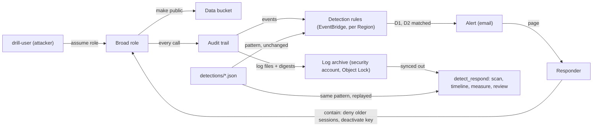

# Architecture

The repository holds the **layer in the account** (Terraform: a tamper-resistant archive, a trail, detection rules with alerts, posture management and a drill that plants a deliberate weakness) and the **responder's tooling** (`detect_respond`: replays detections over the archive, rebuilds a timeline from the logs alone, measures the drill, contains, verifies the archive and baselines the posture). The detections are data in `detections/` and are the one thing both sides share. The component names below are the ones in the lesson's diagram: the `drill-user` and the broad role, the data bucket, the audit trail, the detection rules, the log archive, the alert and the responder.

## Components and what each owns

| Component | Owns | Where |
| --- | --- | --- |
| `drill-user` and the broad role (`drill-broad-role`) | the deliberate weakness: a user that may only assume a role with `PowerUserAccess` | `infra/modules/drill` |
| Data bucket (`drill-data-<account>`) | the target the attacker makes public; Block Public Access off, ACLs on, on purpose | `infra/modules/drill` |
| Audit trail | a multi-region record of every API call, with validation digests, delivered to the archive | `infra/modules/central-trail` |
| Log archive | the evidence: a bucket in the security account with Object Lock in compliance mode, versioning, a customer-managed key and deletes denied to everyone | `infra/modules/log-archive` |
| Detection rules | one EventBridge rule per detection per Region where it can see its events; the pattern is the detection file unchanged | `detections/`, `infra/modules/alerting` |
| Alert | an encrypted topic per Region that emails the responder with who, what, from where and the first step | `infra/modules/alerting`, `detections/alert-template.txt` |
| Responder | the person, with `detect-respond`: replay, timeline, measure, contain, review | `src/detect_respond/`, `scripts/` |
| Posture | AWS Config recording and Security Hub with the best-practices standard; the baseline and accepted risks | `infra/modules/posture`, `src/detect_respond/domain/posture.py` |
| Policy rules | structural guardrails on both plans, including the fence around the drill | `policy/detection.rego` |

## Data flow

One rehearsal, step by step (`make demo-drill`, with the synthetic archive in `fixtures/drill`):

1. `scan` reads every log file in the archive (`DirectoryArchive`, plain or gzip), parses each record once into an `AuditEvent`, and runs every detection's pattern over the EventBridge shape of the event (`event.envelope()`). A failed call matches as well as a successful one. The alert text is rendered from the template the same way the rule's input transformer would.
2. `drill` finds the attacker's calls by the role session name (`intruder`) in `userIdentity.arn`, plus the `AssumeRole` call that created the session, and the responder's containment calls (`PutRolePolicy`, `UpdateAccessKey`). It prints them oldest first, denied calls included, and marks the ones that raise a detection.
3. `measure` takes the first attacker call as time zero. Time to detect runs to the first alert (the event time, or the time the alert reached you if you supply `alerts.json`). Time to contain runs to the first attacker call refused after the revocation. If the attacker never tries again, the tool says containment was not confirmed.
4. `verify-archive` reads each digest file and compares every listed log file's SHA-256 with the file's uncompressed content. An altered or missing file is reported. (The digest signature is checked by the provider's `validate-logs`, which the runbook runs.)
5. `posture` computes the baseline table from two findings files and the accepted risks, and fails on an unfixed critical finding or an acceptance with no reason.
6. `contain` prints what it would do as a plan and as CLI commands; `--apply` does it through the IAM port.
7. `review` writes the blameless review with an event id on every claim, separating what was prevented from what was only recorded.

## Decisions and trade-offs

- **Detections are data** ([ADR 0001](docs/adr/0001-detections-are-data-with-one-source-of-truth.md)). The deployed pattern is the tested pattern, and `audit-rules` proves it from the plan. Cost: a small matcher for the pattern language to keep honest.
- **The archive is in another account, under Object Lock** ([ADR 0002](docs/adr/0002-the-archive-lives-in-another-account-with-object-lock.md)). An administrator of the workload account has no rights in it; even its owner cannot delete a file inside the retention. Cost: the archive outlives the exercise by a day or two, and needs two accounts.
- **Contain sessions, not only the key** ([ADR 0003](docs/adr/0003-contain-sessions-not-only-the-key.md)). Cost: an explicit deny that must be removed when the role is wanted again.
- **Two detection channels.** The EventBridge rules alert in near real time but only see their own Region; the batch scan over the archive sees every Region and every event. D4 is the example: the rule runs only in the Regions it is deployed to, and the scan covers the rest.
- **Layers as folders, enforced.** `domain` depends on nothing, `application` on `domain`, `infrastructure` and `interfaces` on both, nothing on `interfaces`; import-linter fails the build otherwise, and a second contract keeps boto3 out of `domain` and `application`.
- **Time and the account are injected.** The clock and the IAM client are ports; the tests use fakes, the SDK's stubber and a synthetic archive. No test touches a network.
- **The drill is fenced in.** The weakness exists only in the `drill` module, only when `enable_drill` is true, and the OPA rules allow `PowerUserAccess`, IAM users and open Block Public Access nowhere else.
- **Keys never enter the state.** No resource creates an access key; the scripts create the drill and honeytoken keys, keep the drill key in a CLI profile and print nothing secret. An OPA rule rejects an access-key resource.

## Failure modes the lesson teaches, and how the code shows them

| Failure | Where it shows |
| --- | --- |
| The log bucket in the same account | the OPA rule `the logs must go to a bucket outside this account`; ADR 0002 |
| A rule in the wrong Region never fires | D1 and D3 are deployed in us-east-1, D2 in the home Region, D4 in each watched Region; `audit-rules` fails if a detection is missing where its file says it runs |
| An alert with no detail | the template carries who, what, from, region, event id and the first step; the test asserts each field is filled and no placeholder is left |
| Revoking only the key | `contain` always does both; the key alone is not an option in the CLI |
| Building the timeline from memory | `drill` accepts only an archive folder; the review cites an event id for every row |
| Skipping the clock | `drill` takes time zero from the first logged attacker call and prints both measures |
| A pattern with a typo | the matcher raises on an unknown operator; every detection has positive and near-miss tests; `audit-rules` compares the deployed rule to the file |
| An altered log | `verify-archive` reports a changed or missing file (tests alter and delete one) |

## Limits of the teaching build against a production one

- A single trail and one archive bucket. Production adds replication of the archive to a second Region, a separate account for each environment under an organization, service control policies that prevent what the detections only record, and a log analytics layer for queries beyond the batch scan.
- The rules cover three Regions by hand. Production deploys them to every enabled Region with a stack set or a pipeline, or forwards events to one bus.
- Alerting is email. Production pages through an on-call tool and records acknowledgement times, which is also where a true time to detect comes from.
- The batch scan reads a folder synced from the archive; at scale it is a query service over the bucket.
- The matcher implements the part of the event-pattern language the detections use, and the alert transformer was not exercised against a real account.
- Automated response is not built (see ADR 0003), and neither is cross-account access for responders beyond the key policy statement for the security account.
- Posture management is switched on and baselined, not tuned; the accepted-risk file is the record of decisions.

## How to extend it

- **A new detection**: [docs/DETECTIONS.md](docs/DETECTIONS.md), "Add a detection".
- **A watched Region**: add a provider alias and an `alerting` module like `alerting_watch_ap_southeast_2` in `infra/environments/workload`; `audit-rules` already checks every module whose name starts with `module.alerting_watch`.
- **Automated response (stretch)**: a function that calls `contain` for a high-severity detection, with an allow list of roles it may touch, a rate limit and a notification; test it with the fake revoker first.
- **Another cloud**: the domain works on an `AuditEvent` and a pattern; a reader for another provider's audit log that fills the same event, and that provider's rule language for the pattern, reuses the timeline, the measures and the review.
